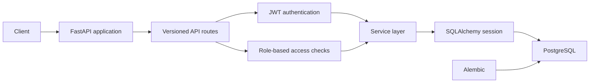
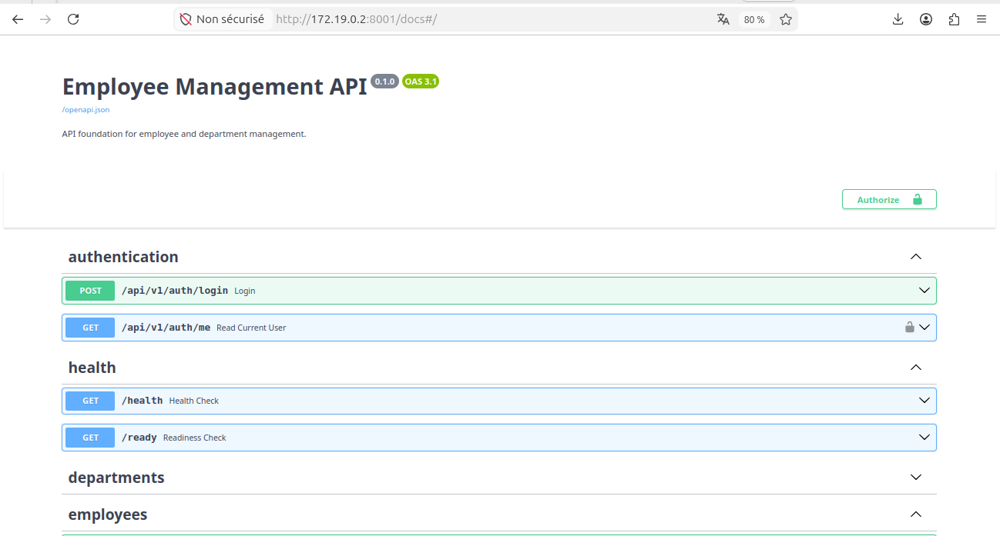
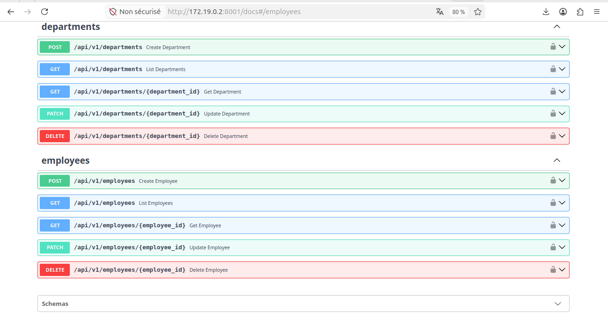
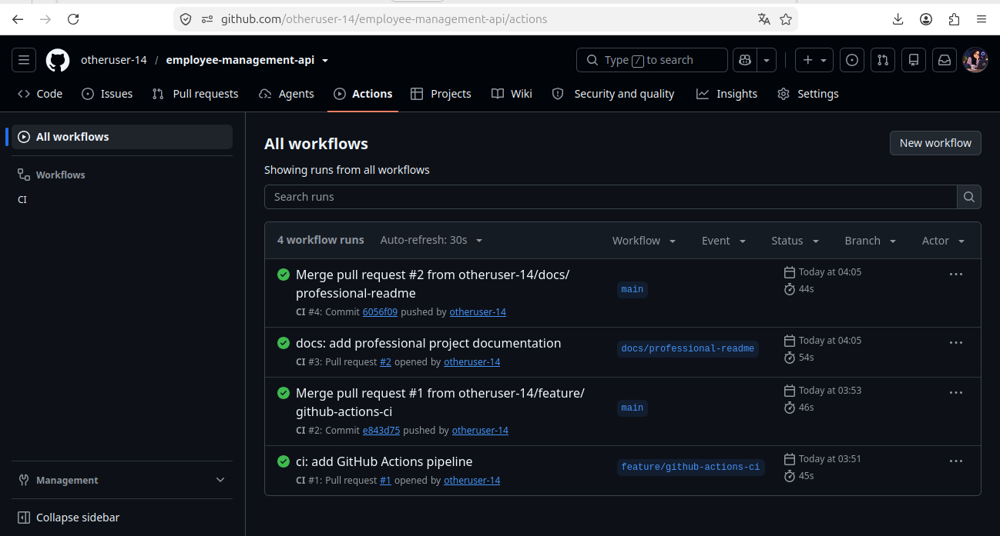

# Employee Management API

[](https://github.com/otheruser-14/employee-management-api/actions/workflows/ci.yml)

A REST API for managing employee and department records, with JWT
authentication, role-based access control, PostgreSQL persistence, and
automated quality checks.

## Features

- Create, list, retrieve, update, and delete departments and employees.
- Paginate department and employee lists; filter employees by department.
- Authenticate with signed, expiring JWT access tokens.
- Authorize protected operations using the `ADMIN`, `MANAGER`, and `EMPLOYEE`
  roles.
- Bootstrap the initial administrator through a one-time interactive CLI
  command; public account registration is not available.
- Manage the PostgreSQL schema with Alembic migrations.
- Run PostgreSQL integration tests and Ruff checks locally and in GitHub
  Actions.

## Technology stack

| Area | Technology |
| --- | --- |
| Language and API | Python 3.11+, FastAPI |
| Data validation and settings | Pydantic v2, Pydantic Settings |
| Database and ORM | PostgreSQL 16, SQLAlchemy 2.0 (synchronous), Psycopg |
| Schema migrations | Alembic |
| Authentication | JWT (HS256), Argon2id password hashing |
| Testing and linting | Pytest, Ruff |
| Local services and CI | Docker Compose, GitHub Actions |

## Architecture

The API router delegates authentication and role checks to reusable
dependencies, then calls service-layer operations. Services use the
SQLAlchemy session to read and write PostgreSQL. Alembic applies schema
migrations to the same database.



The application code is organized under `app/`:

- `api/v1/` — API router, authentication dependencies, and endpoint handlers.
- `schemas/` — Pydantic request and response schemas.
- `services/` — database-backed application operations.
- `models/` — SQLAlchemy models and relationships.
- `core/` — configuration and security utilities.
- `db/` — SQLAlchemy base and session management.
- `migrations/` — Alembic migration environment and revisions.

## Role permissions

All protected routes require a valid JWT access token in the Authorization
header. An unauthenticated request
receives `401 Unauthorized`; an authenticated user without the required
permission receives `403 Forbidden`.

| Operation | ADMIN | MANAGER | EMPLOYEE |
| --- | --- | --- | --- |
| Create, list, retrieve, update, and delete departments | Yes | No | No |
| Create employees | Yes | No | No |
| List employees | Yes | Yes | No |
| Retrieve an employee by ID | Yes | Yes | Own profile only |
| Update employees | Yes | Yes | No |
| Delete employees | Yes | No | No |

An `EMPLOYEE` can retrieve a profile only when the requested employee ID
matches the employee linked to their user account. Requests for another
employee's profile are forbidden. The health checks are public, and the
authentication endpoints are described below.

## API endpoints

All resource endpoints are under `/api/v1`. List endpoints support pagination
with `page` (default `1`) and `page_size` (default `20`, maximum `100`). The
employee list also accepts the `department_id` filter.

| Method | Endpoint | Authorization | Purpose |
| --- | --- | --- | --- |
| `GET` | `/health` | Public | Basic process health check |
| `GET` | `/ready` | Public | Database connectivity readiness check |
| `POST` | `/api/v1/auth/login` | Public | Validate credentials and return an access token |
| `GET` | `/api/v1/auth/me` | Any authenticated user | Return the current user's safe profile |
| `POST` | `/api/v1/departments` | `ADMIN` | Create a department |
| `GET` | `/api/v1/departments` | `ADMIN` | List departments |
| `GET` | `/api/v1/departments/{department_id}` | `ADMIN` | Retrieve a department |
| `PATCH` | `/api/v1/departments/{department_id}` | `ADMIN` | Update a department |
| `DELETE` | `/api/v1/departments/{department_id}` | `ADMIN` | Delete a department |
| `POST` | `/api/v1/employees` | `ADMIN` | Create an employee |
| `GET` | `/api/v1/employees` | `ADMIN`, `MANAGER` | List employees |
| `GET` | `/api/v1/employees/{employee_id}` | `ADMIN`, `MANAGER`, or owning `EMPLOYEE` | Retrieve an employee |
| `PATCH` | `/api/v1/employees/{employee_id}` | `ADMIN`, `MANAGER` | Update an employee |
| `DELETE` | `/api/v1/employees/{employee_id}` | `ADMIN` | Delete an employee |

The API does not expose a public user-registration endpoint. The initial
administrator is created with the bootstrap command shown below.

## Prerequisites

- Docker Engine and the Docker Compose plugin.
- Git, to clone the repository.

## Configure and run with Docker Compose

Clone the repository and move into its directory:

```bash
git clone https://github.com/Charkifatima/employee-management-api.git
cd employee-management-api
```

Create a local environment file from the example:

```bash
cp .env.example .env
```

Edit `.env` and replace the database username and password placeholders.
Set `JWT_SECRET` to a cryptographically random value of at least 32
characters; for example, generate one with:

```bash
openssl rand -hex 32
```

Copy the generated value into the local `.env` file. Do not commit `.env` or
share its contents. The checked-in `.env.example` contains placeholders, not
usable production credentials.

Build and start the API and PostgreSQL services:

```bash
docker compose up --build -d
docker compose ps
```

Apply the database migrations:

```bash
docker compose exec api alembic upgrade head
```

Create the initial administrator. The command prompts for the email and
password without echoing the password, and refuses to create another user
once an account exists:

```bash
docker compose exec api python -m app.cli create-admin
```

The API is available at `http://localhost:8000` by default. The port can be
changed with `API_PORT` in `.env`.

## Environment variables

These are the variables listed in `.env.example`:

| Variable | Purpose | Example/default |
| --- | --- | --- |
| `POSTGRES_DB` | Development database name | `employee_management` |
| `POSTGRES_USER` | PostgreSQL user | Replace the placeholder |
| `POSTGRES_PASSWORD` | PostgreSQL password | Replace the placeholder |
| `DATABASE_HOST` | Database host for local configuration | `localhost` |
| `DATABASE_PORT` | PostgreSQL port | `5432` |
| `API_PORT` | Host port published for the API | `8000` |
| `JWT_SECRET` | Signing key; at least 32 characters | Generate a random value |
| `ACCESS_TOKEN_EXPIRE_MINUTES` | JWT access-token lifetime in minutes | `15` (allowed: `1`–`1440`) |

Docker Compose configures the API and test containers to use the database
service hostname `db`. The integration test workflow uses the dedicated
`employee_management_test` database rather than the development database.

## Database migrations

The API image includes Alembic and the migration files. With the Compose
services running, apply all pending migrations with:

```bash
docker compose exec api alembic upgrade head
```

Alembic reads the database connection settings from the application
configuration. Migrations are not automatically applied when the API starts.

## Tests and code quality

The test suite uses PostgreSQL; SQLite is not supported. The test runner
checks that it is targeting `employee_management_test`, and the test
fixtures apply Alembic migrations before database tests execute.

Run the integration suite in Docker:

```bash
docker compose run --build --rm test
```

Run the configured Ruff checks in a Python environment with development
dependencies installed:

```bash
ruff check .
ruff format --check .
```

## Continuous integration

GitHub Actions runs on pull requests and pushes to `main`. The CI job uses
Python 3.11 and a PostgreSQL 16 service configured for the dedicated
`employee_management_test` database. It installs the project and development
dependencies, runs Ruff lint and format checks, then applies migrations and
runs the full integration suite. A failing check causes the workflow run to
fail.

Open the repository's **Actions** tab, choose **CI**, and select a workflow
run to view its status and individual step logs.

## API documentation

With the API running, open FastAPI's interactive Swagger UI at:

```text
http://localhost:8000/docs
```

The OpenAPI schema is available at `http://localhost:8000/openapi.json`.
Swagger's **Authorize** dialog accepts the JWT credential returned by
`POST /api/v1/auth/login`.

## Future improvements

Potential next steps for the project include:

- Add employee search and sorting options to complement current pagination
  and department filtering.
- Add audit logging for changes to employee and department records.
- Define a token revocation or refresh-token strategy.
- Add deployment automation and operational monitoring.
## Project Screenshots

### Authentication and API Health


### Employee and Department Management


### GitHub Actions CI/CD

